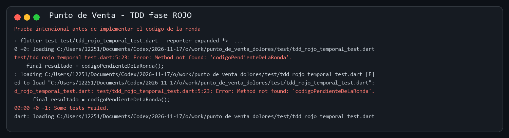
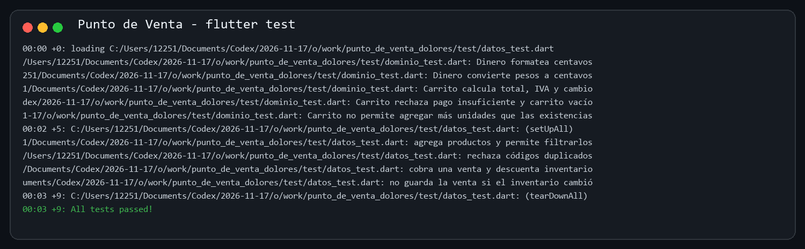

# Punto de venta Dolores

Aplicación Flutter de punto de venta con almacenamiento local SQLite.

## Estructura

- `lib/dominio/`: modelos, reglas de negocio y manejo de dinero.
- `lib/datos/`: base de datos y repositorios.
- `lib/presentacion/`: aplicación y estado de la caja.
- `test/`: pruebas de dominio y de acceso a datos.

## Ejecutar y probar

```shell
flutter pub get
flutter run
flutter test
flutter analyze
```

## Evidencia de pruebas

La suite valida dinero en centavos, carrito, inventario, persistencia y cobro de ventas. Resultado: **9 pruebas aprobadas**.

### Ciclo TDD: rojo a verde

La captura roja reproduce de forma controlada el momento previo a implementar una regla; la verde corresponde a la suite final del repositorio.

| 🔴 Prueba que solicita código faltante | 🟢 Implementación terminada |
|---|---|
|  |  |
